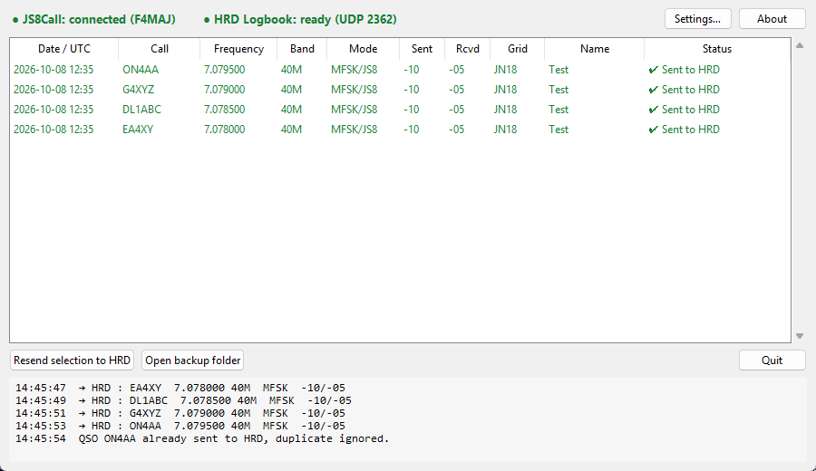

# JS8Call → HRD Logbook

[](https://github.com/LesF4/js8-hrd-bridge/releases/latest)
[](https://github.com/LesF4/js8-hrd-bridge/releases)
[](LICENSE)

[🇫🇷 Français](README.md) · 🇬🇧 English

**Automatically sends every QSO you log in JS8Call to HRD Logbook**, just like WSJT-X
or JTDX do for FT8. JS8Call can't do it on its own: this small app bridges the gap.

Made by **F4MAJ / Jean-Bernard** for the [Les F4](https://github.com/LesF4) community.



## At a glance

- **For whom?** Hams operating JS8 with **JS8Call** and logging in **HRD Logbook** (Ham Radio Deluxe).
- **Nothing changes in your routine:** confirm JS8Call's "Log QSO" window, the contact lands in HRD by itself.
- **Visual:** two status lights (JS8Call / HRD) and the list of sent QSOs with their status.
- **Nothing gets lost:** if HRD is closed, the QSO waits and is sent as soon as HRD starts; every QSO is also saved to an ADIF file.
- **Bilingual** English / French (follows the Windows language).
- **Free and open source** (MIT licence).

## Download

Go to [**Releases**](https://github.com/LesF4/js8-hrd-bridge/releases/latest) and get:

| File | For whom |
|---|---|
| `JS8toHRD-Setup-x.y.z.exe` | **Recommended.** Regular installer: Start menu, desktop icon, start with Windows, clean uninstall. No admin rights needed. |
| `JS8toHRD-portable.exe` | No install: a single file to put anywhere (desktop, USB stick…). |

> **First start:** Windows may show "Windows protected your PC" because the app is not signed (a code-signing certificate costs hundreds of euros per year). Click **More info**, then **Run anyway**. The full source code is right here if you want to check it.

## Step-by-step setup

### 1. Install the app

Run `JS8toHRD-Setup-x.y.z.exe` and follow the steps. Keep these ticked:
- **Create a desktop shortcut**;
- **Start JS8toHRD with Windows**: you'll never have to think about it.

### 2. Configure JS8Call (once)

**File → Settings → Reporting tab**:
- tick **Enable TCP Server API**;
- keep address `127.0.0.1` and port `2242` (defaults);
- leave *Broadcast to N1MM* **unticked**, otherwise each QSO would reach HRD twice.

### 3. Configure HRD Logbook (once)

**Tools → Configure → QSO Forwarding**:
- in the UDP receive section, enable **receiving QSOs sent by other programs** (the same box used for WSJT-X);
- port **`2333`**;
- pick **your logbook** as the target database.

> If you already log WSJT-X into HRD this way, it's probably already set.

### 4. Check

Start JS8Call and HRD Logbook, then the app: **both lights at the top must be green**.
Make a QSO and log it in JS8Call: it shows up in the list ✔ and in your HRD log.

## Usage

| Status | Meaning |
|---|---|
| ✔ **Sent to HRD** | The QSO is in your log. |
| ⏳ **Waiting for HRD** | HRD was closed: the QSO will be sent automatically as soon as HRD starts. |
| ✖ **Send error** | Select it, then **Resend selection to HRD**. |

- **Settings…**: ports, logged mode (`MFSK` + `JS8` submode per the ADIF standard, or `JS8`), language, start with Windows, start minimized.
- The ✕ button hides the app next to the clock (notification area) without stopping it. Right-click the icon → **Quit** to stop it.
- **Open backup folder**: access to `js8call_qsos_backup.adi`, which holds all your JS8 QSOs (importable into any logging program).
- Duplicates (same call, date, time and band) are ignored.

## Troubleshooting

| Problem | Fix |
|---|---|
| **JS8Call light red** | Is JS8Call running? Is *Enable TCP Server API* ticked? JS8Call accepts **only one** program on its API: close other tools that use it. |
| **HRD light red** | Is HRD Logbook open? Is UDP receive on port 2333 enabled in *QSO Forwarding*? |
| **Duplicate QSOs** in HRD | Untick *Broadcast to N1MM* in JS8Call. |
| "The application is already running" | It is: look next to the clock (^ arrow on the taskbar). |
| Antivirus blocks it | Common false positive with packaged Python apps. Add an exception, or use the installer rather than the portable version. |

Question, bug, idea? Open an [**issue**](https://github.com/LesF4/js8-hrd-bridge/issues).

## Where is my data?

In `%APPDATA%\JS8toHRD\` (paste this path into File Explorer):
- `config.json`: your settings;
- `history.json`: the list shown in the window;
- `js8call_qsos_backup.adi`: ADIF backup of all your JS8 QSOs.

Uninstalling **does not delete** these files: they are your QSOs.

## Tested with

- JS8Call 3.0.3
- HRD Logbook 6.9 (Ham Radio Deluxe)
- Windows 11

Other recent versions should work: JS8Call has published logged QSOs on its API since version 2.x. Feedback is welcome.

The app sends standard ADIF over UDP, the "N1MM" format already used by WSJT-X. It may also suit other logging programs that can receive it, but that is untested.

## How it works (for the curious)

```
JS8Call ──(TCP API 2242, LOG.QSO message)──▶ JS8toHRD ──(ADIF over UDP 2333)──▶ HRD Logbook
```

Written in Python (tkinter UI). To run from source, run the tests or build the executable and installer, see [`packaging/README.md`](packaging/README.md).

## Licence

[MIT](LICENSE) © 2026 **F4MAJ / Jean-Bernard**. You may freely use, copy, modify and share this app, as long as you keep the copyright notice.

73 de F4MAJ!
