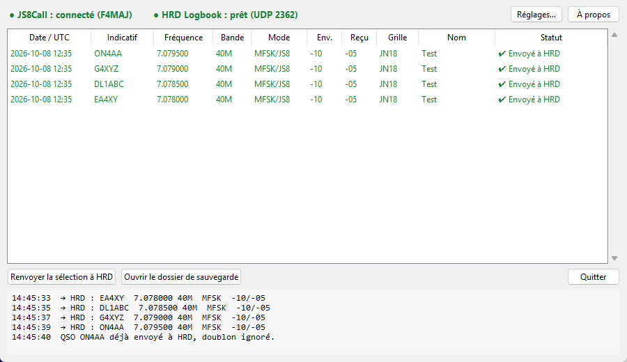

# JS8Call → HRD Logbook

[](https://github.com/LesF4/js8-hrd-bridge/releases/latest)
[](https://github.com/LesF4/js8-hrd-bridge/releases)
[](LICENSE)

🇫🇷 Français · [🇬🇧 English](README.en.md)

**Envoie automatiquement dans HRD Logbook chaque QSO que tu loggues dans JS8Call**,
comme le font WSJT-X ou JTDX pour le FT8. JS8Call ne sait pas le faire tout seul :
cette petite application fait le pont.

Créée par **F4MAJ / Jean-Bernard** pour la communauté [Les F4](https://github.com/LesF4).



## En bref

- **Pour qui ?** Les OM qui trafiquent en JS8 avec **JS8Call** et tiennent leur log dans **HRD Logbook** (Ham Radio Deluxe).
- **Rien à changer à tes habitudes :** tu valides la fenêtre « Log QSO » de JS8Call, le contact arrive tout seul dans HRD.
- **Visuel :** deux voyants (JS8Call / HRD) et la liste des QSO envoyés avec leur statut.
- **Rien ne se perd :** si HRD est fermé, le QSO attend et part dès son ouverture ; chaque QSO est aussi sauvegardé dans un fichier ADIF.
- **Bilingue** français / anglais (suit la langue de Windows).
- **Gratuit et libre** (licence MIT).

## Téléchargement

Va dans les [**Releases**](https://github.com/LesF4/js8-hrd-bridge/releases/latest) et prends :

| Fichier | Pour qui |
|---|---|
| `JS8toHRD-Setup-x.y.z.exe` | **Recommandé.** Installeur classique : menu Démarrer, icône sur le bureau, lancement avec Windows, désinstallation propre. Pas besoin d'être administrateur. |
| `JS8toHRD-portable.exe` | Version sans installation : un seul fichier à mettre où tu veux (bureau, clé USB…). |

> **Premier lancement :** Windows peut afficher « Windows a protégé votre ordinateur », parce que l'application n'est pas signée (un certificat coûte plusieurs centaines d'euros par an). Clique sur **Informations complémentaires** puis **Exécuter quand même**. Le code source est entièrement visible ici si tu veux vérifier.

## Installation pas à pas

### 1. Installer l'application

Lance `JS8toHRD-Setup-x.y.z.exe` et suis les étapes. Laisse cochées :
- **Créer une icône sur le bureau** ;
- **Lancer JS8toHRD au démarrage de Windows** : tu n'auras jamais à y penser.

### 2. Régler JS8Call (une seule fois)

Menu **File → Settings → onglet Reporting** :
- coche **Enable TCP Server API** ;
- laisse l'adresse `127.0.0.1` et le port `2242` (valeurs par défaut) ;
- laisse **décoché** *Broadcast to N1MM*, sinon chaque QSO arriverait deux fois dans HRD.

### 3. Régler HRD Logbook (une seule fois)

Menu **Tools → Configure → QSO Forwarding** :
- dans la partie réception UDP, coche la **réception des QSO envoyés par d'autres programmes** (c'est la même case que pour WSJT-X) ;
- port **`2333`** ;
- choisis **ton logbook** comme base de destination.

> Si tu utilises déjà WSJT-X avec HRD de cette façon, c'est probablement déjà réglé.

### 4. Vérifier

Ouvre JS8Call et HRD Logbook, puis l'application : **les deux voyants en haut doivent être verts**.
Fais un QSO, loggue-le dans JS8Call : il apparaît dans la liste ✔ et dans ton log HRD.

## Utilisation

| Statut | Signification |
|---|---|
| ✔ **Envoyé à HRD** | Le QSO est parti dans ton log. |
| ⏳ **En attente de HRD** | HRD était fermé : le QSO partira tout seul dès que HRD sera ouvert. |
| ✖ **Erreur d'envoi** | Sélectionne-le puis **Renvoyer la sélection à HRD**. |

- **Réglages…** : ports, mode enregistré (`MFSK` + sous-mode `JS8` selon la norme ADIF, ou `JS8`), langue, démarrage avec Windows, démarrage réduit.
- La croix ✕ range l'application près de l'horloge (zone de notification) sans l'arrêter. Clic droit sur l'icône → **Quitter** pour l'arrêter.
- **Ouvrir le dossier de sauvegarde** : accès au fichier `js8call_qsos_backup.adi`, qui contient tous tes QSO JS8 (importable dans n'importe quel logiciel de log).
- Les doublons (même indicatif, date, heure et bande) sont ignorés.

## En cas de souci

| Problème | Solution |
|---|---|
| Voyant **JS8Call rouge** | JS8Call est-il lancé ? *Enable TCP Server API* est-il coché ? JS8Call n'accepte **qu'un seul** programme connecté à son API : ferme les autres outils qui l'utiliseraient. |
| Voyant **HRD rouge** | HRD Logbook est-il ouvert ? La réception UDP sur le port 2333 est-elle activée dans *QSO Forwarding* ? |
| **QSO en double** dans HRD | Décoche *Broadcast to N1MM* dans JS8Call. |
| « L'application est déjà lancée » | Elle tourne déjà : regarde près de l'horloge (flèche ^ de la barre des tâches). |
| Antivirus qui bloque | Faux positif fréquent sur les applications Python empaquetées. Ajoute une exception, ou utilise l'installeur plutôt que la version portable. |

Une question, un bug, une idée ? Ouvre une [**issue**](https://github.com/LesF4/js8-hrd-bridge/issues).

## Où sont mes données ?

Dans `%APPDATA%\JS8toHRD\` (colle ce chemin dans l'Explorateur Windows) :
- `config.json` : tes réglages ;
- `history.json` : la liste affichée dans la fenêtre ;
- `js8call_qsos_backup.adi` : la sauvegarde ADIF de tous tes QSO JS8.

La désinstallation **ne supprime pas** ces fichiers : ce sont tes QSO.

## Testé avec

- JS8Call 3.0.3
- HRD Logbook 6.9 (Ham Radio Deluxe)
- Windows 11

Les autres versions récentes devraient fonctionner : JS8Call publie les QSO loggés sur son API depuis la version 2.x. Tes retours sont les bienvenus.

L'application envoie un ADIF standard en UDP, le format « N1MM » déjà utilisé par WSJT-X. Elle peut donc aussi convenir à d'autres logiciels de log qui savent le recevoir, mais ce n'est pas testé.

## Comment ça marche (pour les curieux)

```
JS8Call ──(API TCP 2242, message LOG.QSO)──▶ JS8toHRD ──(ADIF en UDP 2333)──▶ HRD Logbook
```

Le code est en Python (interface tkinter). Pour le lancer depuis les sources, lancer les tests ou construire l'exécutable et l'installeur : voir [`packaging/README.md`](packaging/README.md).

## Licence

[MIT](LICENSE) © 2026 **F4MAJ / Jean-Bernard**. Tu peux librement utiliser, copier, modifier et partager cette application, à condition de conserver la mention de copyright.

73 de F4MAJ !
